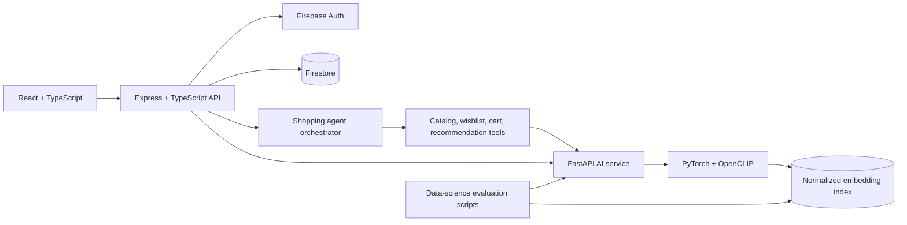

# HEXSHOES

HEXSHOES is a portfolio-scale footwear storefront combining a React customer experience, authenticated Firebase account data, OpenCLIP discovery, transparent content-based recommendations, and a deterministic tool-using shopping assistant. The catalog contains four concept products; it is not a live store and does not claim inventory, payments, shipping, sales, or production-scale performance.

## Architecture



The browser calls Express only. Express owns canonical product data, authentication, authorization, and persisted mutations; FastAPI owns embedding inference and ranking and never accesses Firebase. The shopping agent uses deterministic intent routing—not an LLM—and requires a signed, short-lived confirmation before cart or wishlist changes.

## Implemented capabilities

- Responsive React/Vite storefront with catalog, product, account, wishlist, cart, and editorial routes.
- Firebase email/Google authentication plus server-side revoked-token verification; Firestore profile, wishlist, and cart ownership is derived only from the verified token.
- Real OpenCLIP image, text, and manually weighted multimodal retrieval over four normalized product-image embeddings.
- Product Similar Styles and content-based recommendations from real wishlist/cart signals, with deterministic grounded reasons and honest cold start.
- Grounded shopping agent for discovery, comparison, recommendations, safe account reads, and confirmed cart/wishlist writes.
- Reproducible retrieval metrics, recommendation-mechanics checks, similarity analysis, and exploratory PCA. The eight-query relevance set is manually labeled from the same demo catalog, so results are demonstration metrics—not production benchmarks.

## Technology

React 19, TypeScript, Vite, Express 5, Firebase Auth/Admin/Firestore, FastAPI, PyTorch, OpenCLIP, NumPy, scikit-learn, Vitest, Node test runner, pytest, and Chromium DevTools Protocol verification.

## Local setup

Prerequisites are Node.js 20+, npm, Python 3.11/3.12, and Firebase credentials for authenticated persistence.

```powershell
npm install
npm --prefix frontend install
npm --prefix backend install
py -3.11 -m venv ai-service/.venv
ai-service\.venv\Scripts\python.exe -m pip install -r ai-service\requirements.txt
Copy-Item frontend\.env.example frontend\.env
Copy-Item backend\.env.example backend\.env
npm run dev
```

Services default to frontend `5173`, backend `5000`, and AI `8000`. `npm run health` checks all three. Environment files are ignored; do not commit service accounts, private keys, tokens, or model caches. See each service README and [deployment plan](docs/deployment.md) for configuration.

## Security and reliability boundaries

Express uses Helmet, explicit-origin CORS, 1 MiB JSON/form limits, bounded 5 MiB image uploads with signature validation, Firebase token verification, canonical product resolution, and generic public 500 errors. Agent actions use HMAC-signed, UID-bound, expiring, single-use tokens; production requires an `AGENT_ACTION_SECRET` of at least 32 characters. FastAPI validates decoded images and index/model metadata, confines manifest image paths to the repository, returns structured errors, and has no random embedding fallback. `/health` is process liveness; AI `/status` returns 503 until both model and catalog index are ready.

Logs intentionally exclude ID tokens, confirmation tokens, emails, profile fields, image bytes, and secrets. This is portfolio/demo hardening, not a claim of formal penetration testing, WCAG conformance, an SLA, distributed rate limiting, or production certification.

## Validation and documentation

- [API reference](docs/api.md)
- [Deployment plan](docs/deployment.md)
- [Portfolio claim audit](docs/portfolio-claims.md)
- [3–5 minute demo](docs/demo-script.md)
- [Screenshot plan](docs/screenshot-plan.md)
- [Latest validation evidence](docs/validation-report.md)
- [Data-science methodology](data-science/README.md)

## Screenshots

Screenshots are intentionally not committed in this phase. The capture list is in [docs/screenshot-plan.md](docs/screenshot-plan.md); local verification artifacts stay untracked.

## Limitations and future work

The four-product, one-image-per-product catalog cannot establish broad retrieval or recommendation quality. There is no inventory/size availability, checkout, payment, shipping/returns integration, order history, collaborative filtering, behavioral event pipeline, forecasting, customer segmentation, distributed rate limiter, production monitoring, or deployed environment. Future work should begin with deployment observation, held-out evaluation data, cross-browser/manual assistive-technology testing, and only then scale catalog/index infrastructure where evidence justifies it.

Deployment is **planned, not completed**.
