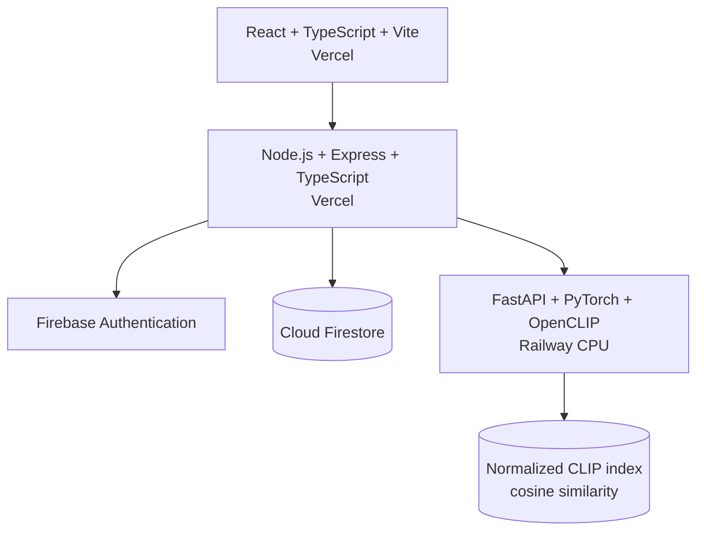

# HEXSHOES

**AI-Powered Retail Intelligence & Agentic Footwear Discovery Platform**

HEXSHOES is a deployed portfolio project combining a premium React storefront, Firebase-backed account state, OpenCLIP semantic retrieval, content-based recommendations, and a deterministic grounded shopping agent. It uses a deliberately small four-product demonstration catalog and does not claim production-scale recommendation quality or retail operations.

## Live demo

- Frontend: [hexshoes.vercel.app](https://hexshoes.vercel.app)
- Backend: [health](https://hexshoes-api.vercel.app/api/health) · [status](https://hexshoes-api.vercel.app/api/status)
- AI service: [health](https://hexshoes-production.up.railway.app/health) · [readiness](https://hexshoes-production.up.railway.app/status)

Free/serverless hosting can introduce cold starts, especially for CPU model inference.

## Key features

- Responsive premium ecommerce presentation with catalog and product views.
- Firebase email/password and Google authentication.
- Firestore-backed profiles, saved styles, and persistent cart state.
- OpenCLIP text, image, and multimodal semantic search.
- Similar Styles and content-based recommendations grounded in catalog products.
- Deterministic explanations based on wishlist, cart, or cold-start strategy.
- Grounded shopping agent with explicit intents and confirmation-gated mutations.
- Reproducible retrieval evaluation on manually labeled same-catalog queries.

## Architecture



The browser communicates with Express rather than calling FastAPI directly. Express verifies identity, owns authorization and mutations, resolves canonical products, and converts AI product IDs into grounded responses. FastAPI owns model inference and ranking and does not access Firebase.

Hosting is split across Vercel for the frontend and backend, Railway for the CPU-hosted AI service, and Firebase for authentication and persisted account data.

## AI and data science

The retrieval service uses OpenCLIP `ViT-B-32` with `laion2b_s34b_b79k` pretrained weights. Each catalog image has a normalized 512-dimensional embedding. Text and images share the CLIP embedding space, and results are ranked by cosine similarity.

Multimodal search combines normalized image and text embeddings using manually configured weights: 60% image and 40% text. Similar Styles uses product-image similarity. Personalized recommendations use wishlist and cart product signals, capped cart-quantity influence, and deterministic reason codes. Collaborative filtering is intentionally absent because the project has no sufficiently large interaction dataset.

Cosine similarity values are similarity scores, not probabilities or confidence estimates.

## Evaluation

The committed eight-query evaluation reports:

| Metric | Result |
| --- | ---: |
| Precision@1 | 1.0 |
| Precision@3 | 0.333333 |
| Recall@3 | 1.0 |
| MRR | 1.0 |
| NDCG@3 | 1.0 |

These are **same-catalog labeled demo evaluation results, not a production benchmark**. The queries were manually labeled against the same four-product catalog.

## Shopping agent

HEX Assistant is deterministic and has no LLM dependency. Its parser routes explicit search, comparison, similarity, recommendation, account, wishlist, and cart intents to existing tools. Responses contain only canonical catalog products and deterministic explanations.

Wishlist and cart mutations use a two-step workflow. The initial message returns a signed, UID-bound, short-lived pending action; only the authenticated confirmation endpoint can execute it. Confirmation tokens are single-use and validated again before mutation.

## Tech stack

| Layer | Technology |
| --- | --- |
| Frontend | React 19, TypeScript, Vite, React Router, Firebase Web SDK |
| Backend | Node.js, Express 5, TypeScript, Firebase Admin, Helmet |
| AI | Python 3.12.10, FastAPI, PyTorch CPU, OpenCLIP, NumPy, Pillow |
| Data | Firebase Authentication, Cloud Firestore, committed CLIP index |
| Quality | Oxlint, TypeScript, Node test runner, Vitest, pytest |
| Deployment | Vercel frontend, Vercel backend, Railway AI service, Firebase |

## Project structure

```text
frontend/      React storefront and Firebase browser authentication
backend/       Express API, Firestore services, and agent orchestration
ai-service/    FastAPI OpenCLIP inference and retrieval
data-science/  Evaluation, similarity analysis, and generated reports
docs/          API, deployment, validation, demo, and portfolio guidance
```

## Local development

Prerequisites: Node.js 20+, npm, Python 3.12, and Firebase credentials for authenticated persistence.

```powershell
npm ci
npm --prefix frontend ci
npm --prefix backend ci
py -3.12 -m venv ai-service/.venv
ai-service\.venv\Scripts\python.exe -m pip install -r ai-service\requirements.txt
Copy-Item frontend\.env.example frontend\.env
Copy-Item backend\.env.example backend\.env
Copy-Item ai-service\.env.example ai-service\.env
npm run dev
```

Local defaults use ports 5173, 5000, and 8000. Run `npm run health` while all three services are running.

## Environment variables

Frontend: `VITE_API_BASE_URL`, `VITE_FIREBASE_API_KEY`, `VITE_FIREBASE_AUTH_DOMAIN`, `VITE_FIREBASE_PROJECT_ID`, `VITE_FIREBASE_STORAGE_BUCKET`, `VITE_FIREBASE_MESSAGING_SENDER_ID`, `VITE_FIREBASE_APP_ID`.

Backend: `PORT`, `NODE_ENV`, `FRONTEND_ORIGIN`, `PRODUCT_DATA_SOURCE`, `FIREBASE_PROJECT_ID`, `FIREBASE_CLIENT_EMAIL`, `FIREBASE_PRIVATE_KEY`, `AI_SERVICE_BASE_URL`, `AI_SERVICE_TIMEOUT_MS`, `VISUAL_SEARCH_MAX_IMAGE_BYTES`, `AGENT_ACTION_SECRET`.

AI service: `AI_HOST`, `AI_PORT`, `CLIP_MODEL_NAME`, `CLIP_PRETRAINED`, `MAX_IMAGE_BYTES`, `CATALOG_MANIFEST`, `CATALOG_INDEX_DIRECTORY`.

Only public Firebase Web SDK configuration belongs in frontend variables. Server credentials and signing secrets must remain in host secret stores.

## Deployment

The Vite frontend and Express serverless adapter deploy independently on Vercel. Express uses the configured frontend origin for CORS and calls the Railway AI service. Railway runs FastAPI with CPU-only PyTorch and loads the compatible catalog index during startup. Firebase provides browser authentication and Firestore persistence. See [docs/deployment.md](docs/deployment.md).

## Validation

- Frontend: lint, typecheck, build, and 25 tests passed.
- Backend: lint, typecheck, build, and 103 tests passed.
- AI: 26 safe tests passed; two real-model integration tests are intentionally excluded from the default suite.
- Production: frontend, backend, Firebase, AI readiness, text search, image search, multimodal search, Similar Styles, personalized recommendations, and shopping-agent routing were validated end to end.

## Limitations

- Four-product demonstration catalog with one indexed image per product.
- Same-catalog evaluation is small in scope and is not a production benchmark.
- CPU inference and free/serverless cold starts can add latency.
- No collaborative filtering or large-scale behavioral dataset.
- No inventory, checkout, payments, orders, shipping, or returns integration.
- No SLA, distributed rate limiting, or production monitoring stack.

## Future work

- Expand the catalog, imagery, and labeled evaluation dataset.
- Introduce a vector database only when catalog scale justifies it.
- Add collaborative signals when sufficient consented interaction data exists.
- Add production monitoring, tracing, and cold-start observation.
- Run broader cross-browser, accessibility, load, and security testing.
- Move to paid compute and operational controls for commercial use.

## Documentation

- [API reference](docs/api.md)
- [Deployment guide](docs/deployment.md)
- [Portfolio claim guidance](docs/portfolio-claims.md)
- [Demo script](docs/demo-script.md)
- [Validation report](docs/validation-report.md)
- [Screenshot plan](docs/screenshot-plan.md)
- [Data-science methodology](data-science/README.md)
